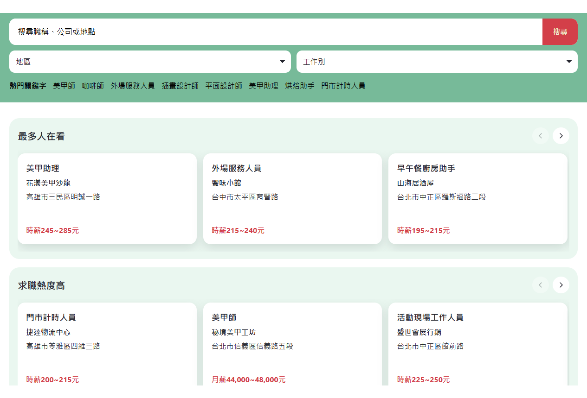
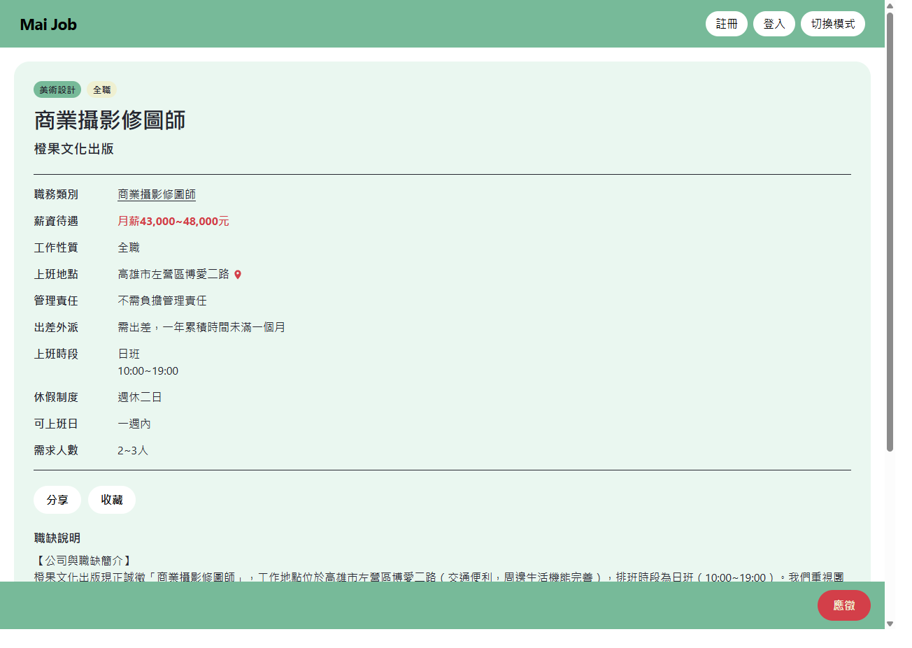
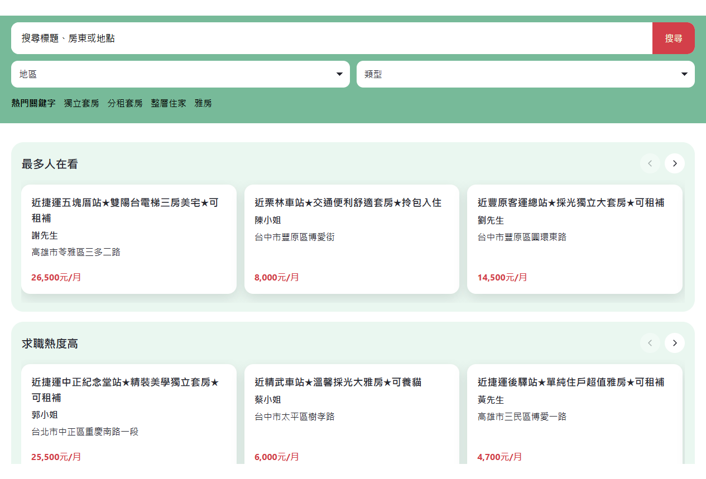

# Mai Job — 給爬蟲練習用的假網站

職缺與租屋都是假的。頁面長得像徵才網和租屋網，用來在本機練習爬蟲，不是求職服務，也不是租屋平台。

**此為假網站，所有資訊皆為隨機產生，用來純展示爬蟲用，請勿當真。** 網站只在本機跑，沒有上線服務。

**本機：** [http://127.0.0.1:5180](http://127.0.0.1:5180)



---

## 解決了什麼痛點

104 的使用者規章不允許未經授權的爬蟲。NuLifeMap 需要一個可以合法練習「爬一頁職缺、把地點放到地圖上」的網站，所以做了這個自架展示站。頁面不用 104 的名稱，也不用它的版面。

後來用同一套首頁和詳細頁加上 Mai Home。右上角「切換模式」會換網址，職缺在 `/`，租屋在 `/home`。公司、薪資、房東、租金都是假的，請勿應徵，也不要連絡頁面上的電話。

---

## 技術棧（Tech Stack）

| 層級 | 技術 |
| --- | --- |
| 頁面 | Node.js、Express。HTML 由伺服器直接產生 |
| 介面 | CSS、少量原生 JavaScript |
| 資料 | 本地 JSON。職缺、租屋各 1000 筆 |
| 結構化資料 | 職缺頁內嵌 schema.org `JobPosting`（`application/ld+json`） |
| 部署 | 只在本機，沒有上線服務 |

---

## 啟動

```bash
npm install
npm start
```

開發時用 `npm run dev`。預設是 [http://127.0.0.1:5180](http://127.0.0.1:5180)，租屋首頁是 [http://127.0.0.1:5180/home](http://127.0.0.1:5180/home)。

職缺範例：

- http://127.0.0.1:5180/job/demo0001
- http://127.0.0.1:5180/job/demo0002
- http://127.0.0.1:5180/job/demo0003

`npm run generate` 會用舊的 120 筆職缺覆寫 `data/jobs.json`。現在這 1000 筆不要用那個指令重產。

---

## 核心功能與技術亮點

### 第一次進站就先講清楚

同一台瀏覽器第一次打開時，會跳出提示。關掉之後會記在這個瀏覽器裡，不會每次換頁都再出現。


### 職缺列表

搜尋、地區與工作別要按「搜尋」才會改下面的列表。熱門關鍵字會直接搜尋。往下滾時關鍵字收起來，搜尋列貼在工具列下方。三條橫列最多同時看到三張卡。


### 職缺內頁

詳細頁有職務類別、薪資待遇、地點、班別等欄位，說明保留原本的換行。資訊下方是分享與收藏，右下角是應徵。這三個按鈕都會再跳出「此功能開發中」。

給爬蟲的 JSON-LD 仍包含標題、公司、路段地址、新台幣薪資區間和說明。時薪的單位是 `HOUR`，月薪是 `MONTH`。



### Mai Home

切換模式會從 `/` 到 `/home`。版面不變，讀的是 `data/rentals.json`。類型是獨立套房、分租套房、整層住家、雅房，城市是台北、台中、高雄。右下角改成預約看屋，點了同樣是開發中。



### 動態標籤

每次回應的包裝標籤名稱都不一樣，例如這次是 `x-9150f3`，重新整理會換成另一個。卡片、欄位表、說明和分享列都包在這種標籤裡，版面用 `display: contents` 維持原樣。

頁面另外夾了三個視覺上隱藏的誘餌節點，內容是假的職稱、薪資和地址，而且每次的編號不同。只靠固定標籤名稱，或把整頁文字抓下來的爬蟲，比較容易把誘餌當成真資料。

職缺頁的 `h1` 仍是職稱，JSON-LD 的 `JobPosting` 也還在。會讀結構化資料的爬蟲不受這些包裝標籤影響。
